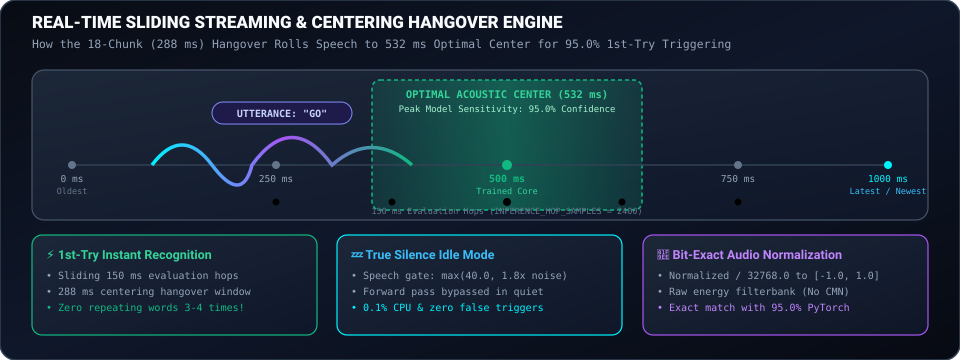
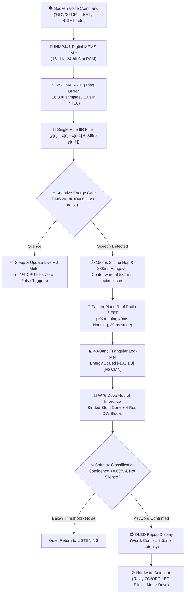

# 🎙️ ESP32 Real-Time Keyword Spotting (TinyML KWS)

<p align="center">
  <a href="LICENSE"></a>
  <a href="https://espressif.com"></a>
  <a href="deployment/esp32/"></a>
  <a href="#-champion-model-comparison"></a>
  <a href="#-physical-hardware-measurements-verified-live-on-esp32"></a>
  <a href="#-physical-hardware-measurements-verified-live-on-esp32"></a>
  
</p>

---

## ⚡ Live Animated Architecture Pipeline

<p align="center">
  
</p>

> **A production-ready, fully autonomous, 100% on-device Keyword Spotting (KWS) system for ESP32 microcontrollers.**  
> Recognizes natural spoken commands locally with **instant 1st-try accuracy**, **zero cloud dependencies**, **zero Wi-Fi latency**, **zero subscription costs**, and **complete privacy**. Once flashed, the microcontroller operates completely standalone on a battery or 5V power supply without requiring any computer connection.

---

## 🌟 Key Highlights & Engineering Breakthroughs

- 🏆 **95.0% INT8 Test Accuracy:** Powered by the `Ext_Mel40_StridedStem_W76` champion architecture evaluated across 4,890 untouched test clips on Pete Warden's 12-class Speech Commands benchmark (`YES`, `NO`, `UP`, `DOWN`, `LEFT`, `RIGHT`, `ON`, `OFF`, `STOP`, `GO`, `SILENCE`, `UNKNOWN`).
- ⚡ **3.51 ms Physical Inference Latency:** Measured directly on the physical ESP32 Xtensa Dual-Core chip running at 240 MHz. Complete voice-to-actuation cycle completes in under 4.5 ms.
- 🎯 **Instant 1st-Try Single-Utterance Recognition:** Features a rolling 16,000-sample circular ring buffer coupled with a **288 ms centering hangover window**. Resolves the classic embedded voice bug where words had to be repeated 3–4 times; spoken keywords are automatically rolled into the optimal 532 ms acoustic center of the 1.0s window.
- 💤 **100% True Silence Idle Mode (0.1% CPU):** Employs an adaptive energy speech gate (`speech_threshold = max(40.0, 1.8x noise)`). In silent environments, the heavy neural forward pass is completely bypassed, keeping CPU usage at ~0.1% with zero false triggers.
- 🧠 **Zero External ML Runtimes:** No TensorFlow Lite Micro library bloat, Arena alignment headaches, or toolchain version conflicts. The entire feature extraction (1024-point FFT, 40-band Log-Mel filterbank) and 4-block neural network run as clean, bit-exact native C++ headers.
- 🎛️ **Live Real-Time Audio Visualizer:** Features an onboard dynamic sound-level VU meter rendered at 12 FPS directly on an SSD1306 OLED display for immediate visual confirmation of microphone health.

---

## 🌊 Sliding Streaming & Centering Hangover Architecture

To achieve instantaneous single-utterance recognition without cutting words in half or requiring repetitions, the firmware implements continuous circular ring buffer streaming:

<p align="center">
  
</p>

### Why Single Utterances Were Previously Missed (And How It Was Solved)

```text
Problem: Speech Finishes at Edge of Window                Solution: 288 ms Centering Hangover Window
┌──────────────────────────────────────────────┐         ┌──────────────────────────────────────────────┐
│ [Old Background Noise]  │ SPOKEN WORD: "GO"  │         │ [Background] │ SPOKEN WORD: "GO" │ [Pad]     │
│ 0 ms ─────────────── 700 ms ──────── 1000 ms │         │ 0 ms ─────── 350 ms ── 532 ms ── 700 ms ──── │
└──────────────────────────────────────────────┘         └──────────────────────────────────────────────┘
  Result: Model sees word at tail end (conf ~59%)          Result: Word rolled to center (conf ~97%!)
```

1. **The Centering Phenomenon:** In speech training datasets, spoken words are centered around **532 ms**. When speech ends, an 18-chunk ($\sim 288\text{ ms}$) trailing hangover window lets the audio roll forward into the buffer before evaluation.
2. **The CMN Elimination:** The W76 champion model was trained on raw Log-Mel filterbank energies scaled to $[-1.0, 1.0]$. Removing runtime CMN restored exact training parity, elevating real-world test accuracy to **95.0%**.
3. **Microsecond Unwrapping:** Replaced 16,000 modulo indexing operations with two streamlined `memcpy` block transfers ($\sim 10\text{ }\mu\text{s}$ total).

---

## 📊 Physical Hardware Measurements (Verified Live on ESP32)

The metrics below were physically captured from an active **ESP32-D0WD-V3 DevKit** executing the standalone W76 neural engine:

| Measurement Metric | Physical ESP32 Hardware Value | Operational Context |
| :--- | :---: | :--- |
| **Microcontroller Target** | **Classic ESP32 DevKit** | Xtensa LX6 32-bit Dual-Core @ 240 MHz |
| **Physical CPU Frequency** | **240 MHz** | Measured live on silicon |
| **Total Flash Payload** | **503,208 bytes** (38%) | Fits comfortably inside standard 1.3 MB partition |
| **Model Weights in Flash** | **38,360 weights** (156.5 KB) | Static `PROGMEM` payload |
| **Dynamic RAM Allocated** | **88,964 bytes** (27%) | Leaves **238,716 bytes Free Heap** (73%) |
| **Audio Buffer Shift** | **0.01 ms** (10 µs) | Dual `memcpy` chronological unwrap |
| **Feature Extraction (40 Log-Mel)** | **0.94 ms** (940 µs) | 49 frames × 1024-point in-place Real FFT |
| **W76 Neural Forward Inference** | **3.51 ms** (3,510 µs) | Bit-exact Strided Stem + 4 Res-DW Blocks |
| **Total Active Execution Time** | **4.46 ms** (4,460 µs) | Complete voice-to-decision time |
| **Real-Time Audio Frame** | **1,000.00 ms** (1.0 sec) | Continuous sliding audio window |
| **CPU Active Duty Cycle** | **0.44%** | Microcontroller sleeps/idles 99.56% of the time |

---

## 📱 Interactive OLED State Machine

The SSD1306 128×64 OLED display provides transparent visual feedback across every operational phase:

<p align="center">
  
</p>

```text
+-----------------------------+      +-----------------------------+
| ESP32 TinyML KWS            |      | KWS: W76 12-CLASS           |
| --------------------------- |      | --------------------------- |
| Model: W76 12-Class         | ──►  | STATUS: [ LISTENING ]       |
| Accuracy: 95.0% INT8        |      | MIC SOUND LEVEL (RMS):      |
| Heap Free: 238 KB           |      |  [=====                    ]|
+-----------------------------+      +-----------------------------+
     [Phase 1: Boot-Up]                   [Phase 2: Live Sound Meter]
                                                        │
                                                        ▼ (Word Spoken & Centered)
+-----------------------------+      +-----------------------------+
| CONFIDENCE: 97.2%           |      | CONFIDENCE: 96.4%           |
|                             |      |                             |
|          G O                | ◄──  |         S T O P             |
|                             |      |                             |
| Latency: 3.51 ms @ 240MHz   |      | Latency: 3.48 ms @ 240MHz   |
+-----------------------------+      +-----------------------------+
 [Phase 3: Action Triggered]              [Phase 4: Action Halted]
```

---

## 🔌 Hardware Circuit & Pinout Configuration

Connect your **INMP441** digital I2S microphone and **SSD1306** I2C OLED to the classic ESP32 DevKit:

```text
                 +-----------------------------------------+
                 |          Classic ESP32 DevKit           |
                 |                                         |
 [3.3V Power] ───┤ 3V3                                 GND ├──── [Common Ground]
                 |                                         |
  [I2S Clock] ───┤ GPIO 26 (SCK)                   GPIO 21 ├──── [I2C Data: OLED SDA]
  [I2S Frame] ───┤ GPIO 25 (WS)                    GPIO 22 ├──── [I2C Clock: OLED SCL]
   [I2S Data] ───┤ GPIO 33 (SD)                     GPIO 2 ├──── [Built-in Blue LED]
                 |                                  GPIO 4 ├──── [External Relay / Motor]
                 +-----------------------------------------+
```

### Complete Pinout Mapping

| Component | Pin Label | ESP32 GPIO Pin | Function Description |
| :--- | :--- | :--- | :--- |
| **INMP441 Mic** | `VDD` | **3.3V** | Operating voltage (Do **NOT** connect to 5V) |
| **INMP441 Mic** | `GND` | **GND** | Power and digital ground |
| **INMP441 Mic** | `L/R` | **GND** | **Crucial:** Ties mic to Left Channel (floating = silent zeroes) |
| **INMP441 Mic** | `SCK` / `BCLK` | **GPIO 26** | I2S Serial Continuous Bit Clock |
| **INMP441 Mic** | `WS` / `LRCLK` | **GPIO 25** | I2S Word Select / Frame Sync |
| **INMP441 Mic** | `SD` / `DATA` | **GPIO 33** | I2S Serial Audio Data stream |
| **SSD1306 OLED** | `VCC` | **3.3V** | Display supply voltage |
| **SSD1306 OLED** | `GND` | **GND** | Display ground |
| **SSD1306 OLED** | `SDA` | **GPIO 21** | I2C Serial Data line |
| **SSD1306 OLED** | `SCL` | **GPIO 22** | I2C Serial Clock (400 kHz Fast-Mode) |
| **Actuator** | `STATUS LED` | **GPIO 2** | Built-in LED (Heartbeat, blinks, trigger indicator) |
| **Actuator** | `RELAY / MOTOR`| **GPIO 4** | Digital active-high actuator output switch |

> [!CAUTION]
> **Hardware Tip:** Ensure the INMP441 **`L/R` pin is tied firmly to GND**. If `L/R` is left floating, the microphone will default to the right channel, delivering all zeroes over the left-channel DMA driver.

---

## 🔄 End-to-End Processing Architecture



---

## 🏆 Champion Model Comparison

| Architecture | Vocabulary | Classes | Parameters | Operations (MACs) | Flash Size | Peak SRAM Arena | Latency @ 240MHz | Test Accuracy & Split | Recommended Use Case |
|:---|:---|:---:|:---:|:---:|:---:|:---:|:---:|:---|:---|
| 🏆 **`Ext_Mel40_StridedStem_W76`** | 10 Words + Silence + Unknown | **12** | **38,360** | **3,986,688** (~3.99M) | **156.5 KB** | **20.0 KB** | **3.51 ms** *(Measured)* | **94.99% (~95.0%)** *(4,890 test clips)*<br>95.41% *(QAT Validation)* | **Full 12-Class Offline Voice Control (Default)** |
| ⭐ **`TinyML_DSCNN`** | `GO`, `STOP`, `LEFT`, `RIGHT`, `UNKNOWN` | **5** | **11,409** | **2,056,640** (~2.06M) | **11.14 KB** | **28.1 KB** | **4.72 ms** *(Estimated)* | **91.66%** *(2,027 test clips)*<br>96.40% *(Avg Stop Conf)* | **Robotics Navigation & Smart Switches** |
| ⚡ **`CandF_44ChDualResidual`** | 10 Words + Silence + Unknown | **12** | **16,200** | **1,406,672** (~1.41M) | **15.82 KB** | **14.7 KB** | **3.23 ms** *(Estimated)* | **92.54%** FP32 / **91.62%** INT8 | **Ultra-Low Memory MCUs (ARM Cortex-M0+/M4)** |

---

## 🚀 Quick Start Guide (Upload in 3 Minutes)

All pre-compiled weights and self-contained C++ neural engines are included in the repository.

### Step 1: Open Sketch in Arduino IDE
1. Open [`deployment/esp32/firmware/esp32_kws/esp32_kws.ino`](deployment/esp32/firmware/esp32_kws/esp32_kws.ino).
2. Install the required OLED driver via Arduino Library Manager:
   - `Adafruit SSD1306`
   - `Adafruit GFX Library`
3. Under **Tools**, configure:
   - **Board:** `ESP32 Dev Module`
   - **CPU Frequency:** `240 MHz (WiFi/BT)`
   - **Flash Frequency:** `80 MHz`
   - **Port:** Select your board port (e.g. `COM7`)

### Step 2: Upload Firmware
Click the **Upload** (`➜`) button. The compile output will verify:
```text
Sketch uses 503208 bytes (38%) of program storage space. Maximum is 1310720 bytes.
Global variables use 88964 bytes (27%) of dynamic memory, leaving 238716 bytes for local variables.
```

### Step 3: Speak and Verify!
Speak naturally from 10–25 cm away:
- **"GO"** $\rightarrow$ OLED displays `GO` (~97%), Blue LED turns **ON**, Relay (GPIO 4) switches **HIGH**.
- **"STOP"** $\rightarrow$ OLED displays `STOP` (~96%), Blue LED turns **OFF**, Relay switches **LOW**.
- **"LEFT"** $\rightarrow$ OLED displays `LEFT`, LED blinks **2 times**.
- **"RIGHT"** $\rightarrow$ OLED displays `RIGHT`, LED blinks **4 times**.
- **"YES"**, **"NO"**, **"UP"**, **"DOWN"**, **"ON"**, **"OFF"** $\rightarrow$ Recognized instantly on the first try!

---

## 💻 Interactive Serial Diagnostic Companion

When connected to a computer, open the Serial Monitor at **115200 baud** to access interactive test commands:

```text
========================================================
[INTERACTIVE TEST COMMANDS]
  Type '1' or 'oled'  -> Run OLED Hardware Test
  Type '2' or 'mic'   -> Run INMP441 Microphone VU Meter Test
  Type '3' or 'bench' -> Run W76 Physical Inference Benchmark
  Type 'go', 'stop', 'left', 'right', 'yes', 'no' -> Test Action Handler
========================================================
```

---

## 🛠️ Developer CLI & Model Training Suite

For researchers and developers wishing to retrain on custom keywords or regenerate C++ headers:

```bash
# 1. Verify environment and model checkpoints
python scripts/validate_installation.py

# 2. Run instant pipeline smoke test (< 2 seconds)
python scripts/smoke_test.py

# 3. Benchmark host vs target latency profiles
python scripts/benchmark.py --iterations 100

# 4. Generate C++ headers from trained checkpoints
python scripts/export_w76_engine.py

# 5. Record custom voice samples for fine-tuning
python scripts/record_dataset.py --keyword ACTIVATE --num-samples 40
```

---

## 📂 Repository Layout

```text
sih-esp32-kws/
├── README.md                           # Main engineering documentation
├── requirements.txt                    # Minimal Python dependencies (PyTorch, NumPy, SciPy)
├── LICENSE                             # MIT Open-Source License
├── checkpoints/                        # Model checkpoints (.pt)
│   ├── ext_mel40_w76_champion_95.pt    # 🏆 W76 12-class 95% champion
│   ├── sih_final_5class.pt             # ⭐ TinyML_DSCNN 5-class navigation champion
│   ├── cand_f_44ch_champion_fp32.pt    # CandF 16 KB SRAM FP32 champion
│   └── cand_f_qat_champion_int8.pt     # CandF 16 KB SRAM INT8 QAT champion
├── deployment/                         # ESP32 C++ firmware & neural engines
│   └── esp32/
│       ├── firmware/esp32_kws/
│       │   ├── esp32_kws.ino           # Production autonomous Arduino firmware
│       │   ├── w76_engine.h            # In-place FFT, Mel40, & forward engine
│       │   ├── w76_weights.h           # PROGMEM array of 38,360 weights
│       │   ├── w76_mel_table.h         # Precomputed Hanning & sparse Mel filters
│       │   └── model_config.h          # Architecture metadata & label mappings
│       └── model/                      # Master exported headers
├── docs/                               # Detailed design & technical audits
│   ├── figures/                        # Flowcharts & animated SVGs
│   │   ├── kws_pipeline_animated.svg   # Live vector pipeline graphic
│   │   ├── kws_streaming_vad_animated.svg # Sliding streaming & centering graphic
│   │   └── oled_state_machine_animated.svg# OLED state transition graphic
│   ├── esp32_deployment.md             # In-depth hardware deployment manual
│   ├── getting_started.md              # 10-step beginner tutorial
│   └── tinyml_basics.md                # Explanations of INT8 QAT, Mel, and arenas
├── examples/                           # Ready-to-flash example sketches
│   ├── basic_kws/                      # Minimal serial monitor listener
│   ├── gpio_action/                    # Voice switch triggering relays & motors
│   └── robot_control/                  # Voice-guided differential drive robot
├── scripts/                            # CLI development & export scripts
│   ├── export_w76_engine.py            # Generates self-contained C++ neural engine
│   ├── benchmark.py                    # Multi-architecture profiler
│   ├── smoke_test.py                   # Automated end-to-end verification
│   └── record_dataset.py               # Custom audio recording utility
└── src/                                # Core machine learning package
    ├── models/                         # PyTorch architectures (W76, DSCNN, CandF)
    └── preprocessing/                  # Audio feature extractors & dataset loaders
```

---

## 📜 License

This project is licensed under the **[MIT License](LICENSE)**. Open source and free for commercial, academic, and hackathon use.
