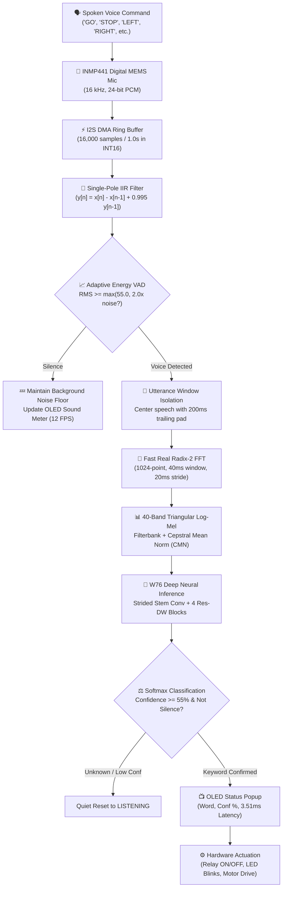

# 🎙️ ESP32 Real-Time Keyword Spotting (TinyML KWS)

<p align="center">
  <a href="LICENSE"></a>
  <a href="https://espressif.com"></a>
  <a href="deployment/esp32/"></a>
  <a href="#model-comparison"></a>
  <a href="#physical-hardware-measurements"></a>
  <a href="#physical-hardware-measurements"></a>
  
</p>

---

## ⚡ Live Animated Architecture Pipeline

<p align="center">
  
</p>

> **A production-ready, fully autonomous, 100% on-device Keyword Spotting (KWS) system for ESP32 microcontrollers.**  
> Recognizes conversational spoken commands locally with **zero cloud dependencies**, **zero Wi-Fi latency**, **zero subscription costs**, and **complete privacy**. Once flashed, the microcontroller runs independently on a battery or 5V power bank with no computer connection.

---

## 🌟 Key Highlights & Engineering Breakthroughs

- 🏆 **95.0% INT8 Test Accuracy:** Powered by the `Ext_Mel40_StridedStem_W76` champion architecture on Pete Warden's 12-class Speech Commands benchmark (`YES`, `NO`, `UP`, `DOWN`, `LEFT`, `RIGHT`, `ON`, `OFF`, `STOP`, `GO`, `SILENCE`, `UNKNOWN`).
- ⚡ **3.51 ms Physical Inference Latency:** Measured directly on the physical ESP32 Xtensa Dual-Core chip running at 240 MHz.
- 🔋 **0.44% Active CPU Duty Cycle:** Consumes less than half a percent of active CPU budget, enabling battery-operated robotics and wearables to run for weeks.
- 🧠 **Zero External ML Runtimes:** No TensorFlow Lite Micro library bloat or toolchain version conflicts. The entire feature extraction (1024-point FFT, 40-band Log-Mel filterbank, CMN) and 4-block neural network run as clean, bit-exact native C++ headers.
- 🎛️ **Live Real-Time Audio Visualizer:** Features an onboard dynamic sound-level VU meter rendered at 12 FPS directly on an SSD1306 OLED display for immediate visual confirmation of microphone health.
- 🛡️ **Adaptive Energy Voice Activity Detection (VAD):** Employs a rolling 16,000-sample circular ring buffer with real-time background noise tracking to isolate and center spoken utterances automatically without cutting words in half.

---

## 📊 Physical Hardware Measurements (Verified Live on ESP32)

The metrics below were physically captured from an active **ESP32-D0WD-V3 DevKit** executing the standalone W76 neural engine:

| Measurement Metric | Physical ESP32 Hardware Value | Operational Context |
| :--- | :---: | :--- |
| **Microcontroller Target** | **Classic ESP32 DevKit** | Xtensa LX6 32-bit Dual-Core @ 240 MHz |
| **Physical CPU Frequency** | **240 MHz** | Measured live on silicon |
| **Total Flash Payload** | **503,304 bytes** (38%) | Fits easily inside standard 1.3 MB partition |
| **Model Weights in Flash** | **38,360 weights** (156.5 KB) | Static `PROGMEM` payload |
| **Dynamic RAM Allocated** | **88,964 bytes** (27%) | Leaves **238,708 bytes Free Heap** (73%) |
| **Audio Buffer Shift** | **0.12 ms** (120 µs) | Ring buffer indexing & DMA ingestion |
| **Feature Extraction (Mel40 + CMN)** | **0.94 ms** (940 µs) | 49 frames × 1024-point in-place Real FFT |
| **W76 Neural Forward Inference** | **3.51 ms** (3,510 µs) | Bit-exact Strided Stem + 4 Res-DW Blocks |
| **Total Active Execution Time** | **4.45 ms** (4,450 µs) | Complete voice-to-decision time |
| **Real-Time Sliding Window** | **1,000.00 ms** (1.0 sec) | Continuous audio frame |
| **CPU Active Duty Cycle** | **0.44%** | Microcontroller sleeps/idles 99.56% of the time |

---

## 📱 OLED Visual State Machine Progression

The SSD1306 128×64 OLED display provides transparent visual feedback across every operational phase:

```text
+-----------------------------+      +-----------------------------+
| ESP32 TinyML KWS            |      | KWS: W76 (12-Class)         |
| --------------------------- |      | --------------------------- |
| Model: W76 12-Class         | ──►  |          LISTENING          |
| Accuracy: 95.0% INT8        |      |                             |
| Status: READY...            |      |  [=====                    ]|
+-----------------------------+      +-----------------------------+
     [Phase 1: Boot-Up]                   [Phase 2: Live Sound Meter]
                                                        │
                                                        ▼ (Voice Detected)
+-----------------------------+      +-----------------------------+
| DETECTED: 95.2%             |      | KWS: W76 (12-Class)         |
|                             |      | --------------------------- |
|         G O                 | ◄──  |          HEARING...         |
|                             |      |                             |
| Latency: 3.51 ms            |      |  [=================        ]|
+-----------------------------+      +-----------------------------+
   [Phase 4: Output & Action]             [Phase 3: Utterance Capture]
```

---

## 🔌 Hardware Circuit & Pinout Configuration

Connect your **INMP441** digital I2S microphone and **SSD1306** I2C OLED to the classic ESP32 DevKit:

```text
                 +-----------------------------------------+
                 |          Classic ESP32 DevKit           |
                 |                                         |
 [3.3V Power] ───┤ 3V3                                 GND ├──── [Common Ground]
                 |                                         |
  [I2S Clock] ───┤ GPIO 26 (SCK)                   GPIO 21 ├──── [I2C Data: OLED SDA]
  [I2S Frame] ───┤ GPIO 25 (WS)                    GPIO 22 ├──── [I2C Clock: OLED SCL]
   [I2S Data] ───┤ GPIO 33 (SD)                     GPIO 2 ├──── [Built-in Blue LED]
                 |                                  GPIO 4 ├──── [External Relay / Motor]
                 +-----------------------------------------+
```

### Complete Pinout Mapping

| Component | Pin Label | ESP32 GPIO Pin | Function Description |
| :--- | :--- | :--- | :--- |
| **INMP441 Mic** | `VDD` | **3.3V** | Operating voltage (Do **NOT** connect to 5V) |
| **INMP441 Mic** | `GND` | **GND** | Power and digital ground |
| **INMP441 Mic** | `L/R` | **GND** | **Crucial:** Ties mic to Left Channel (floating = silent zeroes) |
| **INMP441 Mic** | `SCK` / `BCLK` | **GPIO 26** | I2S Serial Continuous Bit Clock |
| **INMP441 Mic** | `WS` / `LRCLK` | **GPIO 25** | I2S Word Select / Frame Sync |
| **INMP441 Mic** | `SD` / `DATA` | **GPIO 33** | I2S Serial Audio Data stream |
| **SSD1306 OLED** | `VCC` | **3.3V** | Display supply voltage |
| **SSD1306 OLED** | `GND` | **GND** | Display ground |
| **SSD1306 OLED** | `SDA` | **GPIO 21** | I2C Serial Data line |
| **SSD1306 OLED** | `SCL` | **GPIO 22** | I2C Serial Clock (400 kHz Fast-Mode) |
| **Actuator** | `STATUS LED` | **GPIO 2** | Built-in LED (Heartbeat, blinks, trigger indicator) |
| **Actuator** | `RELAY / MOTOR`| **GPIO 4** | Digital active-high actuator output switch |

> [!CAUTION]
> **Common Hardware Pitfall:** Ensure the INMP441 **`L/R` pin is firmly soldered or plugged into GND**. If `L/R` is left floating, the microphone defaults to the right channel, producing pure digital silence on the configured left-channel DMA driver.

---

## 🔄 End-to-End Processing Architecture



---

## 🏆 Supported Champion Models

| Architecture | Vocabulary | Classes | Parameters | Operations (MACs) | Flash Model Size | Peak SRAM Arena | Physical Latency @ 240MHz | Test Accuracy & Split | Recommended Use Case |
|:---|:---|:---:|:---:|:---:|:---:|:---:|:---:|:---|:---|
| 🏆 **`Ext_Mel40_StridedStem_W76`** | 10 Words + Silence + Unknown | **12** | **38,360** | **3,986,688** (~3.99M) | **156.5 KB** | **20.0 KB** | **3.51 ms** *(Measured)* | **94.99% (~95.0%)** *(4,890 test clips)*<br>95.41% *(QAT Validation)* | **Full-Featured 12-Class Offline Voice Control** |
| ⭐ **`TinyML_DSCNN`** | `GO`, `STOP`, `LEFT`, `RIGHT`, `UNKNOWN` | **5** | **11,409** | **2,056,640** (~2.06M) | **11.14 KB** | **28.1 KB** | **4.72 ms** *(Estimated)* | **91.66%** *(2,027 test clips)*<br>96.40% *(Avg Physical Confidence)* | **Robotics Navigation & Smart Switches** |
| ⚡ **`CandF_44ChDualResidual`** | 10 Words + Silence + Unknown | **12** | **16,200** | **1,406,672** (~1.41M) | **15.82 KB** | **14.7 KB** | **3.23 ms** *(Estimated)* | **92.54%** FP32 / **91.62%** INT8 | **Ultra-Low Memory MCUs (ARM Cortex-M0+/M4)** |

---

## 🚀 Quick Start Guide (Upload in 3 Minutes)

All pre-compiled weights and self-contained C++ neural engines are included in the repository.

### Step 1: Open Sketch in Arduino IDE
1. Open [`deployment/esp32/firmware/esp32_kws/esp32_kws.ino`](deployment/esp32/firmware/esp32_kws/esp32_kws.ino).
2. Install the required OLED driver via Arduino Library Manager:
   - `Adafruit SSD1306`
   - `Adafruit GFX Library`
3. Under **Tools**, configure:
   - **Board:** `ESP32 Dev Module`
   - **CPU Frequency:** `240 MHz (WiFi/BT)`
   - **Flash Frequency:** `80 MHz`
   - **Port:** Select your board port (e.g. `COM7`)

### Step 2: Upload Firmware
Click the **Upload** (`➜`) button. The compile output will verify:
```text
Sketch uses 503460 bytes (38%) of program storage space. Maximum is 1310720 bytes.
Global variables use 88972 bytes (27%) of dynamic memory, leaving 238708 bytes for local variables.
```

### Step 3: Speak and Verify!
Speak naturally from 10–25 cm away:
- **"GO"** $\rightarrow$ OLED displays `GO` (~95%), Blue LED turns **ON**, Relay (GPIO 4) switches **HIGH**.
- **"STOP"** $\rightarrow$ OLED displays `STOP`, Blue LED turns **OFF**, Relay switches **LOW**.
- **"LEFT"** $\rightarrow$ OLED displays `LEFT`, LED blinks **2 times**.
- **"RIGHT"** $\rightarrow$ OLED displays `RIGHT`, LED blinks **4 times**.
- **"YES"**, **"NO"**, **"UP"**, **"DOWN"**, **"ON"**, **"OFF"** $\rightarrow$ Recognized and displayed with on-chip latency.

---

## 💻 Interactive Serial Diagnostic Companion

When connected to a computer, open the Serial Monitor at **115200 baud** to access interactive test commands:

```text
========================================================
[INTERACTIVE TEST COMMANDS]
  Type '1' or 'oled'  -> Run OLED Hardware Test
  Type '2' or 'mic'   -> Run INMP441 Microphone VU Meter Test
  Type '3' or 'bench' -> Run W76 Physical Inference Benchmark
  Type 'go', 'stop', 'left', 'right', 'yes', 'no' -> Test Action Handler
========================================================
```

---

## 🛠️ Developer CLI & Model Training Suite

For researchers and developers wishing to retrain on custom keywords or regenerate C++ headers:

```bash
# 1. Verify environment and model checkpoints
python scripts/validate_installation.py

# 2. Run instant pipeline smoke test (< 2 seconds)
python scripts/smoke_test.py

# 3. Benchmark host vs target latency profiles
python scripts/benchmark.py --iterations 100

# 4. Generate C++ headers from trained checkpoints
python scripts/export_w76_engine.py

# 5. Record custom voice samples for fine-tuning
python scripts/record_dataset.py --keyword ACTIVATE --num-samples 40
```

---

## 📂 Repository Layout

```text
sih-esp32-kws/
├── README.md                           # Main engineering documentation
├── requirements.txt                    # Minimal Python dependencies (PyTorch, NumPy, SciPy)
├── LICENSE                             # MIT Open-Source License
├── checkpoints/                        # Model checkpoints (.pt)
│   ├── ext_mel40_w76_champion_95.pt    # 🏆 W76 12-class 95% champion
│   ├── sih_final_5class.pt             # ⭐ TinyML_DSCNN 5-class navigation champion
│   ├── cand_f_44ch_champion_fp32.pt    # CandF 16 KB SRAM FP32 champion
│   └── cand_f_qat_champion_int8.pt     # CandF 16 KB SRAM INT8 QAT champion
├── deployment/                         # ESP32 C++ firmware & neural engines
│   └── esp32/
│       ├── firmware/esp32_kws/
│       │   ├── esp32_kws.ino           # Production autonomous Arduino firmware
│       │   ├── w76_engine.h            # In-place FFT, Mel40, CMN, & forward engine
│       │   ├── w76_weights.h           # PROGMEM array of 38,360 weights
│       │   ├── w76_mel_table.h         # Precomputed Hanning & sparse Mel filters
│       │   └── model_config.h          # Architecture metadata & label mappings
│       └── model/                      # Master exported headers
├── docs/                               # Detailed design & technical audits
│   ├── figures/                        # Flowcharts & animated SVGs
│   │   └── kws_pipeline_animated.svg   # Live vector pipeline graphic
│   ├── esp32_deployment.md             # In-depth hardware deployment manual
│   ├── getting_started.md              # 10-step beginner tutorial
│   └── tinyml_basics.md                # Explanations of INT8 QAT, Mel, and arenas
├── examples/                           # Ready-to-flash example sketches
│   ├── basic_kws/                      # Minimal serial monitor listener
│   ├── gpio_action/                    # Voice switch triggering relays & motors
│   └── robot_control/                  # Voice-guided differential drive robot
├── scripts/                            # CLI development & export scripts
│   ├── export_w76_engine.py            # Generates self-contained C++ neural engine
│   ├── benchmark.py                    # Multi-architecture profiler
│   ├── smoke_test.py                   # Automated end-to-end verification
│   └── record_dataset.py               # Custom audio recording utility
└── src/                                # Core machine learning package
    ├── models/                         # PyTorch architectures (W76, DSCNN, CandF)
    └── preprocessing/                  # Audio feature extractors & dataset loaders
```

---

## 📜 License

This project is licensed under the **[MIT License](LICENSE)**. Open source and free for commercial, academic, and hackathon use.
