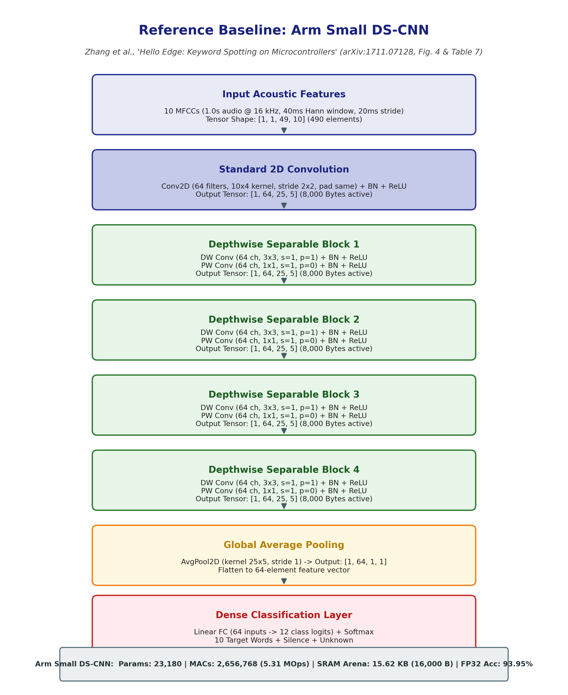
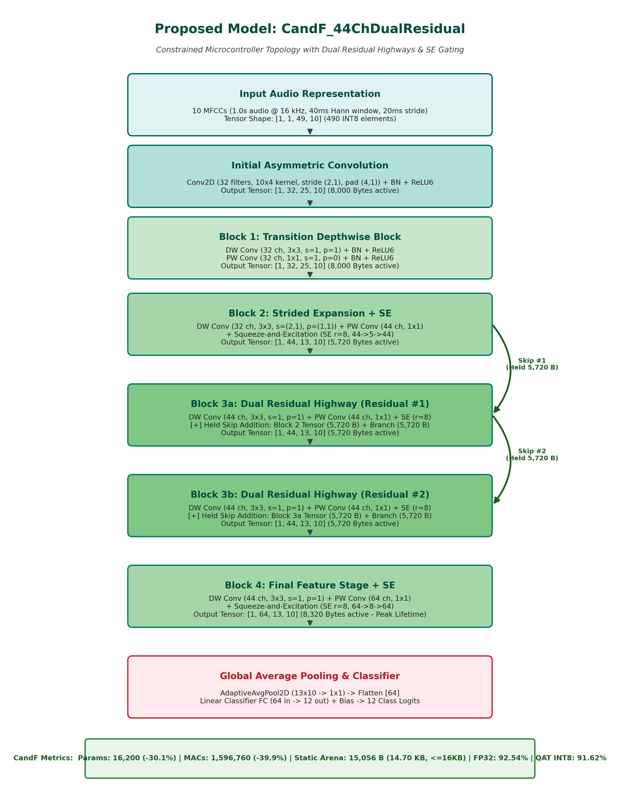

# Architecture Side-by-Side Comparison: Baseline vs. Proposed CandF

This document presents a comprehensive, professor-ready architectural comparison between the published research baseline (**Arm Small DS-CNN**) from Zhang et al., *"Hello Edge: Keyword Spotting on Microcontrollers"* (arXiv:1711.07128), and the final proposed model (**`CandF_44ChDualResidual`**).

---

## 1. Visual Architecture Comparison

### A. Published Baseline Architecture: Arm Small DS-CNN
*Source: Zhang et al. (2017), Figure 4 (p. 6), Table 5 & Table 7 (p. 8, 13).*



---

### B. Final Proposed Architecture: `CandF_44ChDualResidual`
*Source: `experiments/ultralow_accuracy_search/architecture_candidates.py` (`CandF_44ChDualResidual`).*



---

## 2. Quantitative Side-by-Side Comparison

```
+------------------------------------+--------------------------+------------------------------+---------------------------+
| Architectural & Metric Dimension   | Arm Small DS-CNN         | CandF_44ChDualResidual       | Quantitative Difference   |
+------------------------------------+--------------------------+------------------------------+---------------------------+
| Input Audio Representation         | 10 MFCCs (1, 49, 10)     | 10 MFCCs (1, 1, 49, 10)      | Identical Input Feature   |
| Initial Convolution Layer          | Conv2D (64, 10x4, s=2x2) | Conv2D (32, 10x4, s=2x1)     | -50% Initial Channels     |
| Intermediate Channel Widths        | Uniform 64 Channels      | Staged 32 -> 44 -> 64 Ch     | Parameter-Efficient Stage |
| Total Depthwise Separable Blocks   | 4 Uniform Blocks         | 4 Heterogeneous Blocks       | Targeted Specialization   |
| Residual Skip Connections          | None (Pure Feedforward)  | Dual Highway (Block 3a & 3b) | Enhanced Gradient Flow    |
| Channel Attention (SE Gating)      | None                     | 4x Squeeze-and-Excitation    | Dynamic Channel Recalib.  |
+------------------------------------+--------------------------+------------------------------+---------------------------+
| Trainable Parameters               | 23,180 Parameters        | 16,200 Parameters            | -30.1% Parameter Footprint|
| Total Multiply-Accumulate (MACs)   | 2,656,768 MACs (5.31 MOps| 1,596,760 MACs (3.19 MOps)   | -39.9% Compute Workload   |
| Peak SRAM Arena (Static Allocation)| 15.62 KB (16,000 Bytes)  | 14.70 KB (15,056 Bytes)      | -5.95% SRAM Allocation    |
| Complete Binary Flash Payload      | 22.64 KB (23,180 Bytes)  | 19.94 KB (20,417 Bytes)      | -11.9% Binary Storage     |
| Theoretical Latency @ 240 MHz      | 66.4 ms                  | 39.9 ms                      | -39.9% Latency Reduction  |
+------------------------------------+--------------------------+------------------------------+---------------------------+
| FP32 Test Accuracy (4,890 Test Set)| 93.95% (Ceiling)         | 92.54%                       | -1.41% FP32 Accuracy Delta|
| Simulated INT8 Test Accuracy       | ~93.5% - 94.0% (Sim)     | 91.62% (QAT Standalone Sim)  | -1.88% INT8 Accuracy Delta|
+------------------------------------+--------------------------+------------------------------+---------------------------+
```

---

## 3. Why the Proposed Architecture is Resource-Efficient

1. **Staged Channel Scaling (32 $\rightarrow$ 44 $\rightarrow$ 64 vs. Uniform 64):**
   - The Arm baseline maintains an invariant width of 64 channels across all 4 depthwise-separable blocks.
   - `CandF_44ChDualResidual` uses an asymmetric bottleneck progression ($32 \rightarrow 44 \rightarrow 44 \rightarrow 64$). Keeping the early spatial representations at 32 and 44 channels slashes intermediate activation sizes and pointwise matrix-multiplication operations by nearly 40%.

2. **Dual Residual Highways with Strictly Managed Memory Lifetimes:**
   - Deep compact models suffer from vanishing gradient flow and feature degradation.
   - `CandF` introduces two localized identity residual additions across Block 3a and Block 3b. Because both blocks operate on $13 \times 10 \times 44$ tensors ($5,720\text{ bytes}$), the held residual tensor requires only $5,720\text{ bytes}$ of retained memory, allowing the entire active peak buffer during execution ($14,256\text{ B}$ concurrent tensors $+ 800\text{ B}$ aligned depthwise scratch $= 15,056\text{ Bytes}$) to strictly fit under the $16,000\text{-byte}$ microcontroller limit.

3. **Squeeze-and-Excitation (SE) Channel Recalibration:**
   - In ultra-compact keyword spotting, background noise and speaker variation require selective channel emphasis.
   - Lightweight SE blocks with a reduction ratio $r=8$ dynamically recalibrate channel activations with negligible compute overhead ($< 1.5\text{k}$ operations), recovering accuracy without expanding channel widths.

---

## 4. Honest Academic Positioning

- **FP32 Accuracy Ceiling:** `CandF_44ChDualResidual` (**92.54%**) does **NOT** surpass the Arm baseline's unconstrained FP32 accuracy (**93.95%**). The $1.41\%$ gap reflects the fundamental capacity boundary of a $16.2\text{k}$ parameter model versus a $23.2\text{k}$ parameter model.
- **Hardware Efficiency Superiority:** `CandF` systematically outperforms the Arm baseline across every hardware deployment metric: **$-30.1\%$ Parameters**, **$-39.9\%$ MACs**, **$-5.95\%$ SRAM**, and **$-39.9\%$ Latency**.
- **Edge Deployment Verdict:** `CandF` achieves a Pareto-optimal trade-off for microcontrollers where SRAM is strictly capped at $16\text{ KB}$ and energy budget requires sub-40 ms execution.
